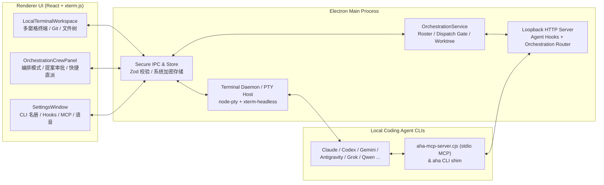

<div align="center">

# AhaStudio

**面向本机多 Coding Agent 协作的桌面端终端工作台与 MCP 编排引擎**

[](./LICENSE)
[](https://www.electronjs.org/)
[](https://react.dev/)
[](https://www.typescriptlang.org/)
[]()

让本机已安装的 Claude Code、Codex、Gemini CLI、Antigravity、Grok 等 10 款 Coding Agent 在统一的多窗格终端中协同工作——内置本地 MCP 编排、Git Worktree 隔离、守护进程持久化、Agent 状态感知与声纹锁定语音输入。

</div>

---

## 核心特性

### 1. 多 Coding Agent 协作与本地 MCP 编排
- **本地 stdio MCP 桥接（`aha`）**：内建 `aha-mcp-server.cjs`，让终端里正在对话的 Agent 直接拥有团队编排能力，无需外部云端中转：
  - **Coordinator 工具**：`list_coding_agents`、`delegate_task`、`team_status`、`team_wait`、`message_worker`、`manage_worker`
  - **Worker 工具**：`report_done`、`ask_coordinator`（授权时可递归派发子任务）
- **Agent 名册与智能选型（Roster & Auto-Routing）**：聚合本机 CLI 安装状态、特长描述、默认模型、Hook/MCP 就绪状态与空闲窗格；`agent: "auto"` 会根据任务类型（`architecture` / `implementation` / `debug` / `tests` / `review` / `research` / `docs`）自动择优，并在代码评审场景优先选择**异构模型**。
- **派发确认闸门（Dispatch Proposal Gate）**：支持 `chat-and-guard`（两步对话确认）与 `always-ui`（界面弹窗审批），拉起 Worker 前可随时确认、取消或临时改派 Agent / Worktree / 模型。
- **Crew 面板与快捷直派**：支持单窗格一键开关**编排模式**、实时查看父子 Worker 谱系与权限审批请求，并在底部直接通过 `@cli 任务` + `WT`（Git Worktree 开关）快捷派活。

### 2. 原生集成 10 款本机 Coding Agent CLI
AhaStudio 直接拉起你本机已安装、已登录的 CLI 工具，沿用各自原有配置与账单，不接管你的模型密钥：

| Agent CLI | 命令 | Agent Hooks 状态/权限感知 | MCP 编排接入方式 |
| :--- | :--- | :---: | :--- |
| **Claude Code** | `claude` | 支持 | 启动参数自动注入（不改全局配置） |
| **Codex** | `codex` | 支持 | 启动参数自动注入（不改全局配置） |
| **Gemini CLI** | `gemini` | 支持 | 设置页一键配置 |
| **Antigravity** | `agy` | 支持 | 设置页一键配置 |
| **Grok** | `grok` | 支持 | 设置页一键配置（TOML） |
| **Qwen Code** | `qwen` | 支持 | 设置页一键配置 |
| **OpenCode** | `opencode` | — | 设置页一键配置 |
| **Qoder CLI** | `qodercli` | — | `aha` CLI 降级协作 |
| **Kimi** | `kimi` | — | `aha` CLI 降级协作 |
| **Pi** | `pi` | — | `aha` CLI 降级协作 |

### 3. 持久化多窗格终端工作台
- **Terminal Daemon 断线续连**：独立终端守护进程托管 PTY 生命周期，应用重启或重载后可自动重连并恢复屏幕快照（含备用缓冲区与滚动历史），支持 Windows Named Pipe ACL 安全加固。
- **分屏与增强链接**：支持水平/垂直分屏、终端内搜索、可点击的文件路径/行号链接、HTTP 链接以及编排 `#task` / `@handle` 快捷跳转。
- **实时状态徽标**：结合 OSC 7501 协议与 Hook 回调，实时追踪每个终端窗格的 `working` / `waiting` / `done` / `error` 状态，并在后台需要人工介入时发出桌面提醒。

### 4. Git 工作区与 Worktree 隔离
- 内置右侧工作区面板，集成**文件树浏览**、**Git 变更与 Unified Diff 视图**以及 **Git Worktree 管理**。
- 支持将选中的 Diff 片段按终端字节上限智能裁剪后直接投递给当前 Coding Agent。
- 编排 Worker 可一键隔离到独立 Git Worktree，避免并行开发时的工作区冲突。

### 5. 语音输入与声纹锁定
- **流式语音识别**：集成讯飞语音听写（IAT）流式 WebSocket 通道与浏览器端 Silero VAD 语音活动检测。
- **声纹锁定（Voice Lock）**：本地 ONNX 声纹模型提取与比对，过滤环境旁人语音干扰。
- **独立语音润色**：可选配置专用润色模型，将口语转写为结构化提示词后直达当前终端；所有敏感凭据均通过系统级加密存储。

---

## 架构概览



---

## 快速开始

### 环境要求
- **Node.js**：建议 `20+`（项目类型定义基于 Node 24）
- **Git**：用于工作区变更检测与 Worker Worktree 隔离
- **本机 Coding Agent CLI**：至少安装一款支持的 CLI（如 `claude`、`codex`、`gemini`、`agy` 等）

### 安装与启动

```bash
# 1. 克隆仓库
git clone https://github.com/AhakeyAI/ahastudio.git
cd ahastudio

# 2. 安装依赖
npm install

# 3. 启动桌面端开发模式（自动拉取可选声纹模型、编译 Electron 并启动 Vite）
npm run dev:electron
```

### 常用脚本

| 命令 | 说明 |
| :--- | :--- |
| `npm run dev:electron` | 启动 Electron + Vite 热更新开发环境 |
| `npm run dev:vite` | 仅启动前端 Vite 开发服务器 |
| `npm run typecheck` | 同时对渲染进程与 Electron 主进程执行 TypeScript 类型检查 |
| `npm test` | 编译 Electron 主进程并运行全部 Node 测试套件（260+ 用例） |
| `npm run build` | 构建生产版前端静态资源与 Electron 主进程代码 |
| `npm run dist` | 打包当前平台的桌面安装包（输出到 `release/`） |
| `npm run dist:dmg` | 构建 macOS arm64 `.dmg` 并校验签名 |

---

## 常用快捷键

| 快捷键 | 功能 |
| :--- | :--- |
| `Ctrl+Shift+O`（macOS: `Cmd+Shift+O`） | 切换当前 CLI 窗格的**编排模式** |
| `Ctrl+Shift+D` / `Ctrl+Shift+E` | 水平 / 垂直分屏 |
| `Ctrl+Shift+[` / `Ctrl+Shift+]` | 在分屏窗格之间切换焦点 |
| `Ctrl+Shift+W` | 关闭当前窗格 |
| `Ctrl+F`（macOS: `Cmd+F`） | 终端内容搜索 |
| `Space`（开启麦克风时） | 快速静音 / 取消静音 |

---

## 目录结构

```text
.
├── electron/                     # Electron 主进程与后台服务
│   ├── agent/                    # Agent 状态存储、Hook/MCP 安装器与环回服务
│   ├── asr/                      # 讯飞流式 ASR 客户端与 PCM16 音频处理
│   ├── git/                      # Git 命令封装、Porcelain 解析与 Worktree 服务
│   ├── ipc/                      # 按域拆分的 IPC 处理器（终端/编排/Git/设置/ASR）
│   ├── orchestration/            # 编排核心服务、Roster、派发闸门、MCP Server 与 CLI shim
│   ├── persistence/              # 原子文件发布与工作区状态持久化
│   ├── shell-integration/        # POSIX/Bash Shell 集成脚本
│   └── terminal-daemon/          # 持久化终端守护进程与 headless 仿真器
├── src/                          # React + TypeScript 渲染进程
│   ├── components/               # 终端工作台、Crew 编排面板、Git/文件树与设置面板
│   ├── hooks/                    # ASR、声纹锁定、窗格与偏好设置 Hooks
│   └── lib/                      # 编排客户端、终端链接解析、跨平台路径工具
├── scripts/                      # 开发启动、构建复制、声纹模型拉取与签名校验脚本
├── tests/                        # 基于 node:test 的单元与端到端集成测试套件
└── electron-builder.json         # 跨平台打包配置（macOS / Windows / Linux）
```

---

## 安全与隔离设计

- **仅环回通信与令牌隔离**：Agent Hook 与编排 HTTP 服务仅监听 `127.0.0.1`，所有请求均校验实例令牌与单窗格令牌（`AHA_ORCHESTRATION_PANE_TOKEN`），并按 Coordinator / Worker 角色隔离权限。
- **不污染外部终端环境**：写入 CLI 配置的 Hook 中继脚本与 MCP 服务仅在检测到 AhaStudio 终端环境变量（`AHA_TERMINAL_ID` / `AHA_AGENT_HOOK_ENDPOINT_FILE`）时生效，外部终端静默跳过。
- **凭据加密与跨平台加固**：语音识别与润色凭据强制加密存储；Windows 终端守护进程管道启用 ACL 权限校验，防止同机未授权进程接入。

---

## 开源协议

本项目基于 [Apache License 2.0](./LICENSE) 开源。部分第三方 CLI 图标素材遵循 [src/assets/cli-icons/THIRD-PARTY-LICENSE.txt](./src/assets/cli-icons/THIRD-PARTY-LICENSE.txt) 中的 MIT 协议。
