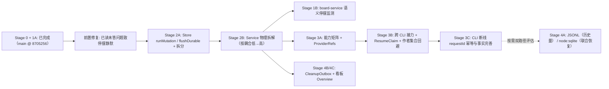

# AhaStudio 编排模块后续演进规划（v6 · `main @ 8705256`）

> **输入依据**：
> - 三方只读调研报告（Aha / Orca / T3 Code 编排架构横向深度调研）
> - `/swarm` 协作机制精华提炼（门铃经济学、零拷贝 `#seq`、语义停摆监测、零成本休眠、交付概览）
> - 仓库实地核验（`main @ 8705256`，2026-11-28；含 PR #15 / #16 / #17 合入后源码级复核）

---

## 1. 核心定位与 `8705256` 实地核验基线

AhaStudio 在**本地多 Agent 编码闭环产品语义**上已经领先同类项目（不可变快照、异构对抗评审、集成分支、`report_done` 结算红线、`unknown_acceptance` 不重发），当前升级主线为**双轨推进**：

1. **协作体验轨（源自 `/swarm` + T3 交接理念）**：降 Token、防卡死自愈、跨 CLI 限额原位接力、看板交付总览。
2. **架构地基轨（源自 Orca 可靠性 + T3 显式边界）**：先定持久化确认与事务边界再拆破万行 Service/Store、完善能力驱动与单写者所有权、按需演进持久化。

### 已合入 `main` 的里程碑

- **PR #13（`feat/multi-driver-orchestration`）**：`driver-capabilities.ts` 为 `codex / claude / antigravity / grok` 开启 `orchestration: true`；新增 `headless-workers.ts`（`HEADLESS_WORKER_DRIVERS` / `headlessWorkerSupports` / `ahaToolDecision` / `sessionGateDecision`）与 `secret-redaction.ts`。
- **PR #14（`feat/headless-worker-controls-3c`）**：新增 `worker-native-questions.ts` 统一托管 Codex / Claude / ACP / Grok 原生提问；前端 `ProposalWorkerControls` 与 `WorkerNativeQuestionCard`。
- **PR #15（`chore/orchestration-handoffs-sync`）**：`codex/orchestration-handoffs` 合入——持久化 worker handoff 与 Git publication evidence、`codeDeps`、`QueuedWorkerLaunch`（`waiting / claimed / needs_reconciliation`）、`IntegrationIntent`、`finalizedBatches`、看板逐接收方回执 `receipts`、`startObservation`、`RunAttention` UI；并附本规划文档（v5）。
- **PR #16（`feat/orchestration-swarm-protocol`）= Stage 1A 已完成**：Coordinator 提示词加入门铃原则 / 零拷贝 `#seq` / `[done]` 归属 / 所有权切分 / 短 Turn / 热休眠复用；Worker 派发 preamble 与 MCP 工具描述（`post_message` vs `message_worker`、`board_wait` vs `team_wait`、`report_done`）同步消歧。
- **PR #17（`codex/fix-agent-communication`）——直接影响后续 Stage 设计，务必先读**：
  1. **精确已读追踪**：新增持久化 `boardReadersByMessageId` 与 `recordBoardRead() / wasBoardPostRead(id, role)`；`read_board(seqs)`、回复、内联投递都会记录"谁读过哪条"。
  2. **游标语义变化**：发帖/回复**不再**推进 `lastReadSeq`；`mentionsOnly` 等待推进独立的 `lastMentionReadSeq`。
  3. **回答问题必须显式**：`message_worker` 需传 `questionId`；`post_message @role` **不再自动回答**待答问题；问题**无过期机制**。
  4. 新增 `post_message(replyTo=#seq|messageId)`；`peek` 统一走 `board-wait` 路径。

### `8705256` 关键文件体量基线

| 文件 | 行数 | 当前状态 |
| --- | --- | --- |
| [`electron/orchestration/orchestration-service.ts`](../electron/orchestration/orchestration-service.ts) | **10,761** | 已含 handoffs/multi-driver/通信修复全量逻辑 |
| [`electron/orchestration/orchestration-store.ts`](../electron/orchestration/orchestration-store.ts) | **4,060** | 单文件 `orchestration-state.json`（上限 200 消息/Run、50 Run，异步写盘），含 `boardReadersByMessageId` |
| [`electron/orchestration/worker-git-integration.ts`](../electron/orchestration/worker-git-integration.ts) | **2,251** | 已含 `IntegrationIntent` 钩子，后续与清理 Outbox 解耦 |
| [`src/components/OrchestrationBoardPanel.tsx`](../src/components/OrchestrationBoardPanel.tsx) | **2,425** | 已有 `board / members / graph`、原生提问与送达状态，缺 `Overview` 与视觉时间线 |
| [`electron/orchestration/headless-workers.ts`](../electron/orchestration/headless-workers.ts) | **114** | 多 driver headless 策略基座（Stage 3A/3B 直接复用与扩展） |
| [`electron/orchestration/worker-native-questions.ts`](../electron/orchestration/worker-native-questions.ts) | **321** | 原生提问生命周期管理器（已独立模块化） |

> **符号锚点（替代行号，Stage 2 后不失效）**：`isPostHiddenByReviewFirewall`、`headlessWorkerSupports` 调用处（`workerStart` 内）、`isNamedSeqLookup`（`boardRead` 内）、`inspectRunsForStallWatchdog`、`lastPostIsDone`、`handleBoardStallDetected`、`resolveActiveParentMailbox`、`settleWorkerReport`。

---

## 2. 不可回退红线（保护清单）

任何重构与新特性都必须保证以下 10 条不变量零退化，并持续遵守技术栈约束（`Electron 45 + React 18 + Vite 6 + TypeScript + 纯 CSS`，不引入 Effect-TS / Tailwind / React 19 / Base UI / TipTap）：

1. **结算隔离**：Turn 结束绝不 settle dispatch，仅显式 `report_done / worker_done` 可结算。
2. **投递防双写**：仅 `not_accepted` 允许 PTY fallback；`unknown_acceptance` 与中断的 `queuedLaunch(claimed)` 绝不自动重发或 fallback（进入 `needs_reconciliation` 核对）。
3. **身份与凭证脱敏**：`dispatchCapability` 与 MCP secret（`secret-redaction.ts`）强校验且在日志、看板、审批、原生提问、交接工件中强制脱敏。
4. **投递围栏**：`consumer_generation` / `consumer_fenced` 严格生效，防止旧进程/旧面板误消费。
5. **不可变快照与防篡改**：临时 `GIT_INDEX_FILE` 生成不可变 OID；拒绝 staged/unstaged 分叉；`strictReviewedTree: true` 阻断 Hook 篡改。
6. **异构对抗评审防火墙**：强制回避**所有参与编写的作者 CLI 集合**（不仅是当前 CLI，单 CLI 机器外）、独立 detached review worktree、隐藏作者自述与作者报告/交接帖（`isPostHiddenByReviewFirewall`）、跨 Run 鉴权隔离。
7. **脏主区保护与目标分支绑定**：脏 `main` 走 `aha/run/<runId>`；严禁 detached HEAD 建集成分支或合错分支（包括人工强制放行）。
8. **审批门禁不可绕过**：`chat-and-guard` / `always-ui` 同时约束 MCP 与 CLI/HTTP 评审入口，以及 `sessionGateDecision` 控制的非 Codex Coordinator 动作。
9. **单写者接管**：页面内人工接管与跨 CLI 接力移交前，必须通过显式所有权锁（claim/fence）与落盘确认，确保原控制者及其子进程均已停止写入。
10. **克制唤醒**：保留 `PeerPingPongTracker` 上限、保留 `nativeQuestions` / `approvals` / `gates` / `proposals` / 未读问答的 `hasPendingAttention` 静默保护，且**只要还有成员处于 `working` 状态，就绝不触发全局停摆告警**。

---

## 3. 演进依赖与推进图

Stage 0 / 1A 已完成，后续所有阶段按 **独立 PR 粒度** 在独立 worktree 中推进；Stage 2 之后 1B / 3A / 4B+4C **互不依赖、可并行**：



---

## 4. 分阶段可执行规划（按独立 PR 拆分）

### Stage 0：分支决策与旧 Worktree 清理 — **已完成**

- `codex/orchestration-handoffs` 经 PR #15 合入；全部旧 worktree、本地与远端已合并分支均已回收。

### Stage 1A：`/swarm` 协议与上下文经济学速赢 — **已完成（PR #16）**

- 门铃原则、零拷贝 `#seq`、`[done]` 专属协调者、所有权切分、短 Turn 纪律、热休眠复用、工具消歧均已落地于 `coordinator-prompt.ts` / `worker-dispatch-preamble.ts` / `aha-mcp-server.cjs`。
- PR #17 已同步修订：`message_worker` 改为显式 `questionId` 回答（不再"自动回答第一个待答问题"），Coordinator 提示词补充 questionId 用法。

---

### 前置修复：已读未答问题导致停摆永久静默（Stage 2 前合入）

- **问题链**（代码核验确认）：PR #17 后问题只能经 `questionId` 显式回答且无过期机制；等待答复的 Worker 推导为 `waiting_input`（非 `working`）；`hasPendingAttention` 把**所有** pending 问答计入静默保护 → 若协调者**已读**问题却未用 `questionId` 回答（崩溃、误用 `post_message @role`、LLM 遗漏），Run 永久停摆且零提示。
- **修复设计**：`inspectRunsForStallWatchdog` 中，`toHandle === 'run:<runId>'` 且协调者**已见过**的未答问题**不再计入** `hasPendingAttention`。"已见过"的判定为两者之一：`wasBoardPostRead(q.messageId, 'coordinator')`（精确已读），**或** `post.boardSeq <= coordinatorCursor.lastReadSeq`（宽泛 `read_board` 只推进游标、不记录精确已读，游标覆盖即算见过）。`handleBoardStallDetected` 在存在此类问题时于停摆帖中点名 `#seq` + `questionId` 并提示用 `message_worker` 回答。未读问题与子 Worker 提问（`toHandle = dispatch:<id>`）维持原静默保护。
- **验收**：已读未答→超阈值发提醒（点名 questionId）；未读→保持静默；已回答→保持静默。

---

### Stage 2：先定持久化确认与事务接口，再物理拆解 Service 与 Store（拆为 2A / 2B 多个独立 PR）

> **核心原则**：Stage 2 **严格零行为变更**，禁止夹带新特性；验收以**职责边界清晰、无循环依赖、持久化确认契约明确**为准，不设死板行数指标。

#### 2A：为 Store 定义统一变更边界与持久化确认契约，再按职责拆分 — **已完成**
- 落地：`orchestration-store.ts` 为 Facade；`orchestration-state-repository.ts`（共享状态、hydrate/export、写盘、`runMutation` / `flushDurable`）+ `orchestration-store-slice.ts`（共享上下文）+ lifecycle / mailbox / security 三个子 store；service 中 5 处 `waitForPendingWrite()` 改为 `flushDurable()`；`persist()` 不再泄漏 unhandled rejection。
- **关键设计**：当前 `AtomicSnapshotWriter` 默认异步写盘（`cd1b3df` 已在关键边界使用 `store.waitForPendingWrite()`），单纯同步 `runTransaction()` 返回并不代表数据已落盘；且 JSONL 不提供 SQL `BEGIN` / `SAVEPOINT`。因此 2A 明确区分两层能力：
  ```ts
  interface OrchestrationUnitOfWork {
    /** 多实体变更合并为单次持久化调度（所有子 store 共享同一写入上下文） */
    runMutation<T>(fn: (tx: OrchestrationStoreTx) => T): T;
    /** 显式等待已提交变更落盘确认（用于移交 claim、结算、释放等崩溃敏感边界） */
    flushDurable(): Promise<void>;
  }
  ```
- **`runMutation` 语义边界（已决策，不做回滚）**：
  - `fn` **必须是同步函数、内部不得 `await`**；JS 单线程保证执行期间无穿插写入，多实体改动对外不可见半成品。
  - **不承诺中途异常回滚**：`fn` 抛错时已改动的内存状态不撤销。配套两条纪律：(a) 所有写路径遵循"先校验、后修改"（沿用 `settleWorkerReport` 中 `assert*Transition` 前置的现有惯例），校验失败必须发生在任何变更之前；(b) 若未来某操作确需回滚，仅对该操作单独引入 undo，不做全局机制。
  - `flushDurable()` **就地包装现有 `flushSync()` / `waitForPendingWrite()`** 并透传写盘错误（顺手修复 `persist()` 丢弃 `writer.write()` Promise 导致的 unhandled rejection）。
  - 普通高频状态更新走 `runMutation(...)`；**崩溃敏感边界（队列 claim、3B 启动新 CLI 前落盘移交记录、Git 发布意图与结算收尾）必须 `await store.flushDurable()` 确认落盘后**再执行外部副作用。
  - 若未来启用 SQLite，`runMutation` 内部直接对接 `BEGIN IMMEDIATE` / `SAVEPOINT` 且同步落盘（`flushDurable` 退化为 no-op），上层零改动。
- **子模块边界**（均接收共享 `tx` 上下文）：
  - `orchestration-state-repository.ts`（持久化与 `flushDurable` 抽象）
  - `orchestration-lifecycle-store.ts`（Run / Task DAG / Dispatch / Settlement / `QueuedWorkerLaunch` / Circuit Breaker）
  - `orchestration-mailbox-store.ts`（Message / Delivery / Receipts / **`boardReadersByMessageId` 精确已读** / Fencing / Question / Gate / Board Cursor——注意 `recordBoardRead` 是 PR #17 新增写入口，同样纳入 `runMutation` 边界）
  - `orchestration-security-store.ts`（Capability 校验、脱敏与容量裁剪）
  - `orchestration-store.ts` 保留为统一 Facade。

#### 2B：将 `orchestration-service.ts`（10,761 行）拆为薄 Facade + 内聚子服务
- **外提顺序按耦合低→高**（每外提 1–2 个子服务即运行 `npm run typecheck` + 定向单测；review / integration / worker-lifecycle 三步合并前必须加跑 `npm run test:e2e`）：
  1. `orchestration-text-views.ts`（`team_status`、看板摘要与快照文本视图——纯格式化、耦合最低，先做）
  2. `board-service.ts`（看板发帖、游标、`receipts`、精确已读、`board_wait`、中场注入、停摆监测——符号锚点 `boardPost` / `boardRead` / `boardWait` / `inspectRunsForStallWatchdog` / `handleBoardStallDetected`）
  3. `review-service.ts`（单 Worker 与 Run 级对抗评审、防火墙、批次汇总、并发启动锁）
  4. `integration-service.ts`（`workerIntegrate`、`runDiff`、`runFinalizeIntegration`、`recoverGitPublications`、集成锁与分支守卫）
  5. `delegation-service.ts`（提案确认链、语义 `delegateTask`、队列发射 `scheduleQueuedLaunches / launchQueuedTask`、角色路由）
  6. `worker-lifecycle-service.ts`（`workerStart` / `followUp` / `stop` / `release` / `abandon` / Headless 桥接，协同 `headless-workers.ts` 与 `worker-native-questions.ts`——耦合最重，最后做）

---

### Stage 1B：在拆分后的 `board-service.ts` 升级语义停摆监测（独立 PR）

- **改动范围**：[`electron/orchestration/stall-watchdog.ts`](../electron/orchestration/stall-watchdog.ts)、拆分后的 `board-service.ts`、[`electron/orchestration/board-protocol.ts`](../electron/orchestration/board-protocol.ts)。
- **与红线 10 及 `[done]` 的精确边界**：
  - **严格遵守红线 10**：所有 4 类停摆诊断**仅在 Run 内所有活跃 Worker 均非 `working`、无 `hasPendingAttention`（审批、原生提问、未读问答、Gate、提案）且协调者 idle 且无活跃 waiter 时才触发**。
  - **收紧 `lastPostIsDone`**：仅当发帖者是 `coordinator` 且包含 `[done]` 时才视为 Run 已收尾，防止 Worker 误写 `[done]` 静默监测；**必须保留 `kind === 'stall'` 条件**——否则 watchdog 会被自己发出的停摆帖再次触发，形成循环。
- **"已读 / 已处理"判定（PR #17 后大幅简化，以精确已读为准）**：
  - **已读证据取两者的并集**：`wasBoardPostRead(postId, 'coordinator')`（精确已读）**或** `post.boardSeq <= coordinatorCursor.lastReadSeq`（宽泛读覆盖）。单独用任何一个都会漏：宽泛 `read_board` 只推进游标不记精确已读，而 `read_board(seqs)` 点读只记精确已读不推进游标。注意发帖/回复自 PR #17 起不再推进 `lastReadSeq`，`mentionsOnly` 等待推进的是 `lastMentionReadSeq`（其内联投递已记精确已读，无需再查该游标）。
  - **"读而未处理"仍需业务事实补判**：已读不等于已处理。报告帖满足以下任一即视为已处理：`post.receipts['coordinator'] === 'replied'`、协调者对其发过引用回复/认领帖、或对应任务/dispatch 已推进（开评审、已集成、已 follow-up、已重派或关闭）。
  - **"协调者未读停驻"诊断重写**：`mentionsOnly` 等待推进的是 `lastMentionReadSeq` 而非 `lastReadSeq`，**禁止**用 `headSeq > lastReadSeq` 判未读（会大量误报）；改为遍历发给协调者的帖子、用精确已读集合筛出未读项。
- **状态优先 + 零浪费 4 类诊断**：
  1. **报告未处理**：已读或未读但无"已处理"业务依据且未 `@coordinator` 的报告帖 → 点名 `#seq` 提醒 `@coordinator`。
  2. **协调者未读停驻**：按精确已读集合存在未读的 `@coordinator` 消息 → 列出 `#seq` 提醒。
  3. **`@mention` 未获回复（先查状态再决定动作）**：某等待态 Worker 的 `lastMentionedSeq > lastPostSeq` 时：
     - **先检查 driver / session 诊断状态**（错误码、进程退出或 `usageLimits` 限额信号）：若已确认报错或限额，**绝不浪费 Token 发 re-ping turn**，直接一步升级 `@coordinator` 建议换 CLI 接力或人工处理；
     - 仅当 Worker 存活、无报错、无限额信号时，才定向 re-ping 该 `@role` **至多 1 次**；若下个周期仍无新发帖，立刻升级 `@coordinator`。
  4. **兜底全局静默**：未发协调者 `[done]` → 带各成员最后 `#seq` 提醒 `@coordinator`。
- **统一计数与防空转重置**：
  - 将停摆提醒退避计数与现有 `PeerPingPongTracker` 收口到同一 Run 级唤醒预算管理器，同一停摆上限 3 次即静默。
  - **关键约束**：只有**实质进展**（新任务/评审派发、任务/集成状态推进、人工输入、或非系统触发的有效业务回复）才重置 3 次上限；**系统停摆提醒唤醒协调者后，若协调者结束 turn 但任务没有任何进展，绝不能重置 3 次上限**。
- **验收用例清单**：
  1. 覆盖 4 类诊断；
  2. 有 `working` 成员或 `nativeQuestions` 未答时不误报；
  3. 协调者点读报告并已回复/启动评审/集成后，不再误报该报告未处理；
  4. 限额/报错直接升 Coordinator，不浪费 Headless re-ping turn；
  5. 系统提醒唤醒协调者但任务无进展时，计数不重置，达到 3 次后稳定静默；
  6. **watchdog 自己发出的 `stall` 帖不会再次触发提醒**（`kind === 'stall'` 抑制保留）。

---

### Stage 3：能力驱动、跨 CLI 原位接力与幂等恢复（拆为 3A / 3B / 3C 三个独立 PR）

#### PR 3A：就地扩展能力矩阵、`headless-workers.ts` 与 `ProviderRefs`
- **基础**：直接建立在已有 [`driver-capabilities.ts`](../electron/agent-drivers/driver-capabilities.ts) 和 [`headless-workers.ts`](../electron/orchestration/headless-workers.ts) 之上，不重复实现已有的 `headlessWorkerSupports / headlessWorkerControlsError / ahaToolDecision / sessionGateDecision`。
- **增量内容**：
  1. 在 `AgentDriverCapabilities` 补充尚未声明的编排维度：`nativeThreadIds: 'strong' | 'weak' | 'none'`、`acceptsDeveloperContext`、`supportsSteer`、`hookApprovalDialect`，收口 [`permission-approvals.ts`](../electron/orchestration/permission-approvals.ts) 和 service 内残余的 `cliId` 硬编码分支。
  2. 引入结构化 `ProviderRefs`（App ID 为主身份，Provider session/thread/turn/request ID 仅作引用证据）。
  3. 将散落的策略判断收敛进 `headless-workers.ts` / `orchestration-policy.ts`，能力不足时返回显式结构化原因。

#### PR 3B：跨 CLI 原位接力 + `ResumeClaim` 单写者锁 + 作者集合回避（拆 3B-1 / 3B-2 两个 PR）
- **基础**：直接复用已合入的 `needs_reconciliation`、`reconciliationDiff` 与 `QueuedWorkerLaunch` 落盘认领模式，在其之上扩展可审计、经过 `secret-redaction.ts` 与 capability 脱敏的 `ContextTransfer / ContextHandoff` 工件，绝不起第二套平行结构。
- **PR 3B-1（所有权与进程回收，先行）**：
  1. 引入显式 `ResumeClaim / WorktreeOwnershipFence`，**claim 中记录 pid / job 句柄**；页面内人工接管同步切到同一套 claim。
  2. **推广现有 [`windows-codex-job.ts`](../electron/orchestration/windows-codex-job.ts)（当前仅服务 Codex）到全部 headless driver**；macOS / Linux 用进程组回收（`kill(-pgid)`）。
- **PR 3B-2（接力本体）四条硬约束**：
  1. **目标 CLI 筛选严格复用现有启动判断**（`workerStart` 内 `headlessWorkerSupports` 调用处）：
     - 必须通过 `headlessWorkerSupports(targetCli, workerPolicy)` 且校验运行时可用性（`headlessWorkers.available?.(targetCli) !== false` / `codexPilot.enabled()`）；
     - 沙箱 root 锁定同一 worktree，策略**宁严勿宽**：`antigravity` / `grok` 无 `read-only` 档，禁止接力只读 headless 任务；**`pi` 和 `opencode` 当前完全没有 headless Worker 支持，即使人工同意切换权限也不可作为 headless 接力目标**（仅显式降级为终端 Worker 流程）。
  2. **红线 6（异构评审作者集合回避）**：**复用 [`agent-roster.ts`](../electron/orchestration/agent-roster.ts) 已实现的 `authorCliIds / excludeCliIds` 机制**（Run 级评审已传 `integratedAuthorClis`），本 PR 只做两件增量：(a) 接力链路上把累计作者集合持久化到 Worker 记录；(b) 单 Worker 评审把该集合传入 roster。仅当所有可用 CLI 均已参与编写时才显式降级并标明原因。
  3. **红线 9（单写者 + 写入静止核验）**：移交前先中断原 CLI、回收其子进程组；"写入静止"的判定必须可操作化——**进程树为空，且相隔 N 秒的两次 worktree 快照 OID 一致**；若检测到残留后台进程仍在写入，**保留 worktree 现状并暂停移交**，绝不放行双写。
  4. **两阶段落盘 + 崩溃恢复（防双实例）**：
     - **第一段**：启动新 CLI **之前**，先把 `pending` 态移交记录与 `ResumeClaim`（含拟用 targetCli、worktree、来源 dispatch）写入 Store 并 `await store.flushDurable()`；
     - **第二段**：拉起新 CLI 拿到 provider thread id 后，再写 `active` 态并二次 `flushDurable()`；
     - **重启恢复规则（写死）**：发现 `pending/active` 移交记录时，先按 claim 中记录的 pid / job 回收可能存活的孤儿进程（Windows 上 Electron 崩溃不保证子进程退出），随后将该移交标记为 **`needs_attention` 交人工处理**，**绝不自动续跑、绝不重复拉起第二份 Worker**。
- **附带能力**（可独立后续 PR）：`delegate_task(forkFrom: "@role")` 热上下文派生（评审模式依然经过对抗防火墙，隐藏作者自述）。
- **必须覆盖的验收用例（含 2 条关键失败验收）**：
  1. **正常闭环**：保留同一 worktree 未提交改动完成跨 CLI 接力，作者集合 `{A, B}` 触发异构评审回避，脱敏无凭证泄露，最终通过评审合入；
  2. **能力与策略拒绝**：`antigravity/grok` 拒绝接力 `read-only` headless 任务；`pi / opencode` 即使请求切权也因无 headless 支持而被 `headlessWorkerSupports()` 拒绝；
  3. **失败验收 1（残留子进程仍在写文件）**：旧 CLI 已确认中断，但模拟其衍生的后台进程仍在改写 worktree 文件 → 系统必须**保留 worktree 不清理、暂停移交并返回明确错误**，不得启动新 CLI 造成双写；
  4. **失败验收 2（拉起新 CLI 后、落盘成功前崩溃）**：移交记录落盘后拉起新 CLI，模拟在写入 `active` 之前应用崩溃 → 重启后恢复流程回收孤儿进程、标记 `needs_attention`，**绝不再启动第二份重复 Worker**。

#### PR 3C：CLI 断线 `requestId` 幂等与观测事实补齐（优先级低于 3A / 3B）
- **定位说明**：LLM Agent 调用 MCP 时通常不会跨次携带同一 `requestId` 重试，此项主要服务于 **CLI/HTTP 断线自动重试与前端防重复点击**，排在 3A/3B 之后按轻量范围实现。
- **内容**：
  1. 在已有 `startObservation` 与 `IntegrationIntent / finalizedBatches` 基础上，补齐只增不改的 `AttemptObservationFact` 关键事件覆盖（turn、approval、native question、snapshot、handoff、integration）。
  2. 为 HTTP/CLI 写入口（`worker-start / worker-integrate / run-finalize / worker-release`）增加 `(callerFingerprint, requestId)` 幂等收据与 `--retry-request <id>` 恢复指引，同 ID 异载荷返回 `request_mismatch`。

---

### Stage 4：收尾 Outbox、看板总览与按需演进持久化（4B / 4C 独立推进，4A 按需双路径）

#### PR 4B：克制版 `CleanupOutbox`（不依赖 SQLite，可独立先做）
- **明确边界**：仅纳入**幂等、可安全重试的资源收尾副作用**：
  - `worker.release`（worktree 删除 + 分支 CAS 清理）
  - `review_worktree.cleanup`（detached review worktree 清理重试）
  - `run_branch.cleanup`（收尾后 `aha/run/<runId>` 清理）
- **明确禁区**：**严禁把 `codex.start_turn` 或 `pty.deliver_prompt` 纳入自动重发 Outbox**，保证 `unknown_acceptance` 不重发红线永不被破坏。进程重启后自动扫描未完成清理队列并幂等补清。

#### PR 4C：看板「交付总览（Overview）」+ 视觉时间线 + 游标分流（不依赖 SQLite）
- **基础**：直接兼容 `openNativeQuestions`、`ProposalWorkerControls`、`WorkerNativeQuestionCard`、`RunAttention` 及最新 snapshot 合流机制。
- **改动范围**：[`OrchestrationBoardPanel.tsx`](../src/components/OrchestrationBoardPanel.tsx)、[`orchestration-board-model.ts`](../src/lib/orchestration-board-model.ts)、[`orchestration-client.ts`](../src/lib/orchestration-client.ts)。
- **内容**：
  1. **派生式 Overview 页签（借鉴 `swarm_pane`）**：协调者只维护极简目标与按**交付成果**分组的 `threads`，进度/评审门禁/阻塞问答状态全部从看板和 Store 实时派生。
  2. **视觉变更时间线**：解析看板贴中的 `Screenshot: <path> | <简短说明>` 行（校验仅允许工作区或合法 artifact 目录路径），渲染前后对比缩略图时间线。
  3. **游标分流订阅**：将前端大快照合并逐步拆为 `runOverview` + `boardCursorStream(since)` + `workerTimelineStream(dispatchId)`，结合引用缓存投影降低大 Run 渲染开销。

#### Stage 4A（按需双路径，不预设强制迁移）
基于 Stage 2A 的 `OrchestrationUnitOfWork` / `flushDurable()` 抽象，后续仅在真实痛点出现时分别评估以下两条独立路径：

1. **路径 A（历史量与截断成为痛点时）→ 评估 Append-only JSONL**：
   - 将只增不改的消息流与观测事实拆出为按 Run 切分的 append-only JSONL 文件，核心热状态仍由原子快照维护，以低改造成本解除 200 消息 / 50 Run 截断与全量覆盖写瓶颈（不强求 JSONL 提供 SQL 事务语义）。
2. **路径 B（多项状态需要联合原子恢复/复杂查询成为痛点时）→ 评估 `node:sqlite`**：
   - 借助 Electron 45（Node `24.22.2`）内置 `node:sqlite` + `BEGIN IMMEDIATE` / `SAVEPOINT` 与 `schema_migrations` 实现跨实体事务恢复与独立资源表；
   - **发布门槛（Release Gate）**：由于 Node 24 中 `node:sqlite` 仍为实验 API（含 `ExperimentalWarning`），任何基于 `node:sqlite` 的实现合入发布前，必须通过 **Windows NSIS / macOS arm64 DMG / Linux AppImage 打包态（asar）三平台实测**。

---

## 5. 明确暂缓项（P3 / 触发条件未到不做）

| 暂缓项 | 暂缓原因 | 何时再启动 |
| --- | --- | --- |
| **T3 全量 Event Sourcing + ExecutionNode Graph** | 复杂度远超当前本地桌面编排收益；状态表 + `AttemptObservationFact` 已满足审计需求 | 当需要多层嵌套子代理可视化执行树与任意时间点全状态重放时 |
| **多频道（`channels` + `@#channel`）与分片批派（`tasks`）** | 2–6 人规模下多频道增加路由心智负担 | 当单 Run 常态化出现 8+ 并行 Worker 或多模块独立子团队时 |
| **Checkpoint + Provider 对话联合回滚** | 跨 CLI 对话回滚支持度差异大，工程风险极高 | 当 Stage 3 能力矩阵与持久化稳定后作为独立特性评估 |
| **多机远程/联邦编排** | 当前核心场景为本地工作台 | 产品正式规划远程 Host/云端 Worker 时 |

---

## 6. 统一交付与验证门禁

每个 PR 均遵循统一闭环：
1. 在 `../ahastation-local-cli.aha-worktrees/<branch>` 独立工作树开发；
2. 补齐对应单元/集成回归测试；
3. 运行 `npm run typecheck` + `npm run test:fast`（触及 review / integration / worktree / 核心生命周期 / Store 持久化边界时必须加跑 `npm run test:e2e`）；
4. 逐项核对第 2 节 10 条红线无回退后再合入 `main`。
